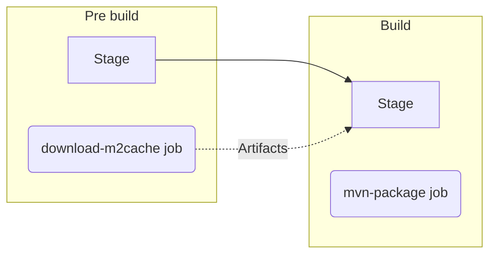

# Lab2 - アーティファクトの活用

## 目次
[[_TOC_]]

## 目的
* ジョブの成果物を後のステージに渡すために、キーワード `artifacts` の活用を理解します。
* ジョブ `download-m2cache` を前のステージに追加することで、前 Lab で時間のかかったビルドジョブの実行時間の短縮を行います。以降の Lab のパイプライン実行時間も改善できます。

## ハンズオンの課題
### 完成予定のパイプライン


### イシューとマージリクエストの作成
イシューのタイトルを “Add download cache job” とし、
[Lab1 のイシューとマージリクエストの作成](../lab1/README.md#イシューとマージリクエストの作成) を参照して同様に操作します。

### キャッシュダウンロードのジョブの追加
ジョブ `mvn-package` よりも前のステージでキャッシュをダンロードし、アーティファクトとして保存するジョブ `download-m2cache` を追加します。保存したアーティファクトはジョブ `mvn-package` に受け渡されます。
1. マージリクエストのページで、[Web IDE で開く] をクリックします。
1. Web IDE の左側のソースコードのツリーから [.gitlab-ci.yml] をクリックし、以下の定義対象の指示とテンプレートにしたがってのジョブ定義を追加します。
    * 定義対象
      |対象|値|解説|
      | :--- | :--- | :--- |
      |アーティファクトのPath指定|`./.m2/`|リポジトリのルート直下の `.m2` ディレクトリです。|
      |ジョブ `download-m2cache` の実行ステージ名|`pre build`|ステージ `build` のための準備ステージです。|
      |追加の実行スクリプト|任意の Linux コマンド + `\|\| true`|（任意実施）キーワード `script` にセットしたコマンドがちゃんとジョブに反映されているか確認するためにも、知っている Linux コマンドをいくつかスクリプトに加えてみましょう。本ジョブの実行環境である Alpine Linux の Docker イメージには入っていないコマンドである可能性もあるため、ジョブを失敗させないよう後ろに `\|\| true` をつけます。おすすめのコマンド：`curl wttr.in/Tokyo \|\| true`。|
    * テンプレート
      ```yaml
      download-m2cache:
        stage: <Code here>
        image: alpine:3.14.1
        script:
          - apk --no-cache add curl
          - curl -L -o m2.zip "https://workshop.gitlabtraining.cloud/api/v4/projects/sample-project-templates%2flocal-cache-for-basic-cicd-workshop/jobs/artifacts/main/download?job=mvn-package"
          - if [ -e ./m2.zip ]; then unzip m2.zip; fi
        artifacts:
          <Code here>:
            - <Code here>
      ```
    * （読み飛ばし可）周辺の解説
        * キーワード `script` で事前に別プロジェクトでビルドしておいたアーティファクトを API でダウンロードし、`./.m2/` 配下に解凍する処理をしています。
        * 外部からダウンロードしたアーティファクトは、本ジョブのアーティファクトとして再度保存（アップロード）しています。
        * 本来は、キャッシュ的な用途なので適切なスコープを設定したキーワード `cache` を活用するべきですが、本ワークショップ環境では GitLab Runner をまたいだキャッシュが動作しないため、アーティファクトで代用しています。
        * なるべく高速に動作させるために、軽量な Alpine Linux の Docker イメージを指定しています。

### ステージの追加
ジョブの追加のともない、対応するステージも定義します。 
1. `pre build` というステージを `stages` の配列として `build` の前に追加します。
    * ヒント
      ```yaml
      stages:
        - <Code here>
        - build

      download-m2cache:
      ...
      mvn-package:
      ...
      ```
### ソースコードのコミット
[Lab1 の .gitlab-ci.yml のコミット](../lab1/README.md#ソースコードのコミット) を参照して同様に操作します。

### パイプライン実行結果の確認
1. マージリクエストのページで、[#] から始まるパイプラインのIDをクリックし、パイプラインの詳細を確認します。
1. パイプラインのページからそれぞれのジョブをクリックし、以下のアーティファクトのアップロード、ダウンロードのログがあることを確認します。
    * download-m2cache
      ```log
      Uploading artifacts...
      .m2: found 6421 matching files and directories     
      Uploading artifacts as "archive" to coordinator... ok  id=235227 responseStatus=201 Created token=2HG6Vv5P
      ```

    * mvn-package
      ```log
      Downloading artifacts for download-m2cache (235227)...
      Downloading artifacts from coordinator... ok        id=235227 responseStatus=200 OK token=2HG6Vv5P
      ```
      * ジョブ `mvn-package` については、[Duration:] の値を確認し、前 Lab より高速化され、1分程度で完了していることを確認します。
1. [Mark as ready] ボタンをクリックします。
1. [マージ] ボタンをクリックし、マージリクエストをマージします。（本 Lab 以降は承認ボタンのクリックは任意とします。）


# ハンズオンの解答
* [Lab2 解答](../lab2/SOLUTION.md)


