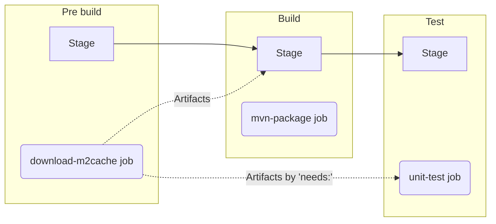

# Lab3 - テストの実行

## 目次
[[_TOC_]]

## 目的
* ユニットテストの実行結果を GitLab のマージリクエストやパイプラインに反映するための方法を理解します。
* キーワード `needs` を活用し、依存するジョブが完了次第、ジョブの実行開始をする方法を理解します。


## ハンズオンの課題
### 完成予定のパイプライン



### イシューとマージリクエストの作成
イシューのタイトルを “Add unit test job” とし、
[Lab1 のイシューとマージリクエストの作成](../lab1/README.md#イシューとマージリクエストの作成) を参照して同様に操作します。

### ユニットテストのジョブの追加
ジョブ `mvn-package` の後のステージに、ジョブ `unit-test` を追加します。
ジョブ `unit-test` はジョブ `mvn-package` は待たずにジョブ `download-m2cache` が完了次第、開始するよう定義します。
1. マージリクエストのページで、[Web IDE で開く] をクリックします。
1. Web IDE の左側のソースコードのツリーから [.gitlab-ci.yml] をクリクし、以下の定義対象の指示とテンプレートにしたがってのジョブ定義を追加します。
    * 定義対象
      |対象|値|解説|
      | :--- | :--- | :--- |
      |Junit XMLの生成先|`target/surefire-reports/TEST-*.xml`|値はテンプレートにセット済みであるため、ここでは必要なキーワードをセットしましょう。ユニットテスト実行用 Maven Surefire Plugin による一般的な XML レポートの生成先です。|
      |依存先ジョブ|`download-m2cache`|ジョブ `unit-test` はジョブ `mvn-package` は待たずにジョブ  `download-m2cache` が完了次第、開始するよう定義します。|
    * テンプレート
      ```yaml
      unit-test:
        stage: test
        image: maven:3.8.1-openjdk-17-slim
        script:
          - ./mvnw test
        artifacts:
          when: always
          paths:
            - target/surefire-reports/TEST-*.xml
          <Code here>: 
              <Code here>:
                - target/surefire-reports/TEST-*.xml
        <Code here>: 
          - <Code here>
      ```
    * （読み飛ばし可）周辺の解説
        * `./mvnw test` は Maven によるテスト実行のコマンドです。
        * オリジナルの XML ファイルもダウンロードできるようにするため、**通常の**アーティファクトを `artifacts:paths` により設定してします。
          * さらに `artifacts` に `when: always` を設定することで、テストが失敗した場合も通常のアーティファクトがダウンロードできるようにしています。

### ステージの追加
ジョブの追加のともない、対応するステージも定義します。 
1. `test` というステージを `stages` の配列として `build` の後に追加します。

### ソースコードのコミット
[Lab1 の .gitlab-ci.yml のコミット](../lab1/README.md#ソースコードのコミット) を参照して同様に操作します。

### パイプライン実行結果の確認
* ユニットテスト結果の確認を確認します。
  1. マージリクエストのページで、[テストの要約 には テスト結果に変更ありません。 テスト全件数 40 のうち が含まれています] のテスト結果の概要を確認します。
  1. [レポート全体を見る] ボタンをクリックし、パイプラインとしてのテスト結果の概要を確認します。ここでスキップされたテストが１件存在すること、テストコード実行時間は５秒前後であることが確認できます。
* アーティファクトのダウンロードをします。 
  1. パイプラインのページ中央のマージリクエストのリンク [!3 Draft: Resolve "Add unit test job"] から、マージリクエストのページに戻ります。
  2. ３つの緑のパイプライン成功アイコンの、右のダウンロードアイコンから [Download unit-test:junit artifact] （`artifacts:reports:junit`により生成）を選択し、`junit.xml.gz` をダウンロードします。gz ファイルが解凍できる環境であれば解凍し、`junit.xml` の内容を確認します。
      * gzファイルがすぐに解凍できない場合は、代わりに [Download unit-test:archive artifact] （`artifacts:paths` により生成）から `artifacts.zip` をダウンロードしましょう。
* キーワード `needs` によるジョブの依存関係を確認します。
  1. マージリクエストのページで、[#] から始まるパイプラインのIDをクリックし、パイプラインの詳細を確認します。
  1. [Job dependencies] をクリックします。[Show dependencies] のスイッチをオンにし、ジョブの依存関係が想定どおりか確認します。

* マージリクエストをマージします。
  1. [Mark as ready] ボタンをクリックします。
  1. [マージ] ボタンをクリックし、マージリクエストをマージします。

# ハンズオンの解答
* [Lab3 解答](../lab3/SOLUTION.md)


