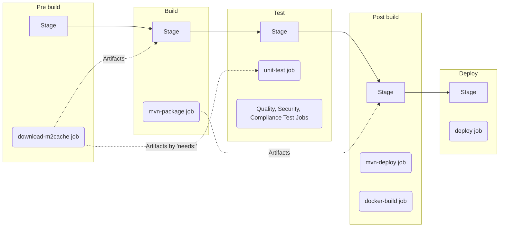

# Lab7 - Web アプリケーションのデプロイ
## 目次
[[_TOC_]]

## 目的
* GitLab CI/CD パイプラインによる、Docker イメージのビルド方法の一例を確認します。
* GitLab CI/CD パイプラインによる Web アプリケーションのデプロイ方法は、デプロイ環境の構成により様々ありますが、GitLab Auto Deploy をベースとしたデプロイ方法を一例として確認します。
* GitLab にはマージリクエストをマージする前の段階で、Web アプリケーションの UI が確認できる Review App 機能があります。`environment:` を正しく定義することで、Web アプリケーションの動的な URL リンクを Review App として、マージリクエスト内に設定できることを理解します。


## ハンズオンの課題
### 完成予定のパイプライン
* In Default Branch


### イシューとマージリクエストの作成
イシューのタイトルを “Add deploy job” とし、
[Lab1 のイシューとマージリクエストの作成](../lab1/README.md#イシューとマージリクエストの作成) を参照して同様に操作します。

### docker build、deploy、stop-deploy のジョブの追加
以下の `docker build`、`deploy`、`stop-deploy` のジョブを追加します。さらに、ハンズオン実施の時間短縮のため、ここでは各種スキャンジョブに依存しないようにします。

|ジョブ|解説|
| :--- | :--- |
|`docker build`|Web アプリケーションの jarファイルを取り込む Docker イメージのビルドします。[Docker-in-Docker](https://docs.gitlab.com/ee/ci/docker/using_docker_build.html#docker-in-docker-with-tls-disabled) や [GitLab Auto Build のテンプレート](https://gitlab.com/gitlab-org/gitlab/blob/master/lib/gitlab/ci/templates/Jobs/Build.gitlab-ci.yml) を参考にしています。 Docker のタグ名を `$CI_REGISTRY_IMAGE/$CI_COMMIT_REF_SLUG:$CI_COMMIT_SHA` とすることで、コミットごとに一意のイメージビルドをします。|
|`deploy`|[GitLab Auto Deploy のテンプレート](https://gitlab.com/gitlab-org/gitlab/blob/master/lib/gitlab/ci/templates/Jobs/Deploy.gitlab-ci.yml)を流用し、Kubernetes クラスタへデプロイします。ブランチごとに一意の URL や namespaceが自動的に取得されます。Helm Chart 等のデプロイ環境情報も GitLab Auto Deploy の仕組みで自動的に提供されています。
|`stop-deploy`|マージリクエスト内でのレビュー用にデプロイ（Review App 機能）したデプロイを、マージリクエストマージ後に破棄するためのクリーンアップ用のジョブです。手動によるジョブボタンのクリック、もしくは `environment:` の `action: stop` の設定により、[ブランチが削除された際に実行されます](https://docs.gitlab.com/ee/ci/environments/#stop-an-environment-when-a-branch-is-deleted)。|


1. マージリクエストのページで、[Web IDE で開く] をクリックします。
1. Web IDE の左側のソースコードのツリーから [.gitlab-ci.yml] をクリックし、以下のテンプレートを追記します。

* テンプレート

```yaml
docker-build:
  stage: post build
  image: docker:20.10.6
  variables:
    DOCKER_TLS_CERTDIR: ''
  services:
    - name: 'docker:20.10.6-dind'
      command: ['--tls=false', '--host=tcp://0.0.0.0:2375']  
  before_script:
    - docker login -u $CI_REGISTRY_USER -p $CI_REGISTRY_PASSWORD $CI_REGISTRY
  script:
    - docker build -t $CI_REGISTRY_IMAGE/$CI_COMMIT_REF_SLUG:$CI_COMMIT_SHA .
    - docker push $CI_REGISTRY_IMAGE/$CI_COMMIT_REF_SLUG:$CI_COMMIT_SHA
  rules:
    - if: '$CI_COMMIT_TAG || $CI_COMMIT_BRANCH'
  needs:
    - mvn-package
    - unit-test

.auto-deploy:
  image: "registry.gitlab.com/gitlab-org/cluster-integration/auto-deploy-image:v2.12.0"
  dependencies: []

deploy:
  extends: .auto-deploy
  stage: deploy
  script:
    - auto-deploy check_kube_domain
    - auto-deploy download_chart
    - auto-deploy ensure_namespace
    - auto-deploy initialize_tiller
    - auto-deploy create_secret
    - auto-deploy deploy
    - auto-deploy persist_environment_url
  environment:
    name: review/$CI_COMMIT_REF_NAME
    url: http://$CI_PROJECT_ID-$CI_ENVIRONMENT_SLUG.$KUBE_INGRESS_BASE_DOMAIN
    on_stop: stop-deploy
  artifacts:
    paths: [environment_url.txt, tiller.log]
    when: always
  rules:
    - if: '$CI_KUBERNETES_ACTIVE == null || $CI_KUBERNETES_ACTIVE == ""'
      when: never
    - if: $CI_COMMIT_BRANCH
  needs:
    - docker-build

stop-deploy:
  extends: .auto-deploy
  stage: cleanup
  variables:
    GIT_STRATEGY: none
  script:
    - auto-deploy initialize_tiller
    - auto-deploy delete
  environment:
    name: review/$CI_COMMIT_REF_NAME
    action: stop
  allow_failure: true
  rules:
    - if: '$CI_KUBERNETES_ACTIVE == null || $CI_KUBERNETES_ACTIVE == ""'
      when: never
    - if: $CI_COMMIT_BRANCH
      when: manual
```
### mvn-package のジョブのアーティファクトの保存
jar ファイルを後のステージに受け渡すことにより、ジョブ `docker-build` でビルドする Docker イメージの中に jar ファイルを含めます。

```yaml
mvn-package:
  stage: build
  image: maven:3.8.1-openjdk-17-slim
  script:
    - ./mvnw package -Dmaven.test.skip=true  
  artifacts:          # この行を追加
    paths:            # この行を追加
      - target/*.jar  # この行を追加
```

### ステージの追加
ジョブの追加のともない、対応するステージも定義します。 
1. `deploy` と `cleanup` のステージを `stages:` の最後に追加します。
* テンプレート
```yaml
stages:
  - pre build
  - build
  - test
  - post build
  - release
  - deploy # この行を追加
  - cleanup # この行を追加
```

### 環境変数 ROLLOUT_RESOURCE_TYPE のセット
1. 以下のとおりに、`ROLLOUT_RESOURCE_TYPE` の設定を追加します。
* テンプレート
```yaml
variables:
  MAVEN_OPTS: "-Dmaven.repo.local=$CI_PROJECT_DIR/.m2/repository -Dcheckstyle.skip=true"
  ROLLOUT_RESOURCE_TYPE: deployment # この行を追加
```

### Dockerfile の新規追加
1. ジョブ `docker-build` で利用する Dockerfile の定義を新規に追加します。
```Dockerfile
FROM maven:3.8.1-openjdk-17-slim

WORKDIR /usr/src/app
COPY target/*.jar /usr/src/app/
ENV PORT 5000
EXPOSE $PORT

CMD java -jar /usr/src/app/*.jar --server.port=$PORT
```


### ソースコードのコミット
[Lab1 の .gitlab-ci.yml のコミット](../lab1/README.md#ソースコードのコミット) を参照して同様に操作します。

### パイプライン実行結果の確認
1. マージリクエストのパイプラインの実行が成功したら、マージリクエストのページの [アプリを表示] ボタンをクリックし、
Spring Petclinic の Web UI を表示できることを確認します。（Review App 機能）
1. Spring Petclinic のページでブラウザのアドレスバーを確認し、一意の URL（サブドメイン）が発行されていることを確認します。
1. Spring Petclinic のページで [FIND OWNERS] をクリックします。
1. [Last name] に "Black" を入力し、[Find Owner] ボタンをクリックし、[Jeff Black] のオーナー情報が表示され、アプリケーションが正常に動作していることを確認します。
1. [Mark as ready] ボタンをクリックします。
1. [マージ] ボタンをクリックし、マージリクエストをマージします。
1. main ブランチでも同様なアプリケーションのデプロイジョブが開始することを確認します。

# ハンズオンの解答
* [Lab8 解答](../lab7/SOLUTION.md)