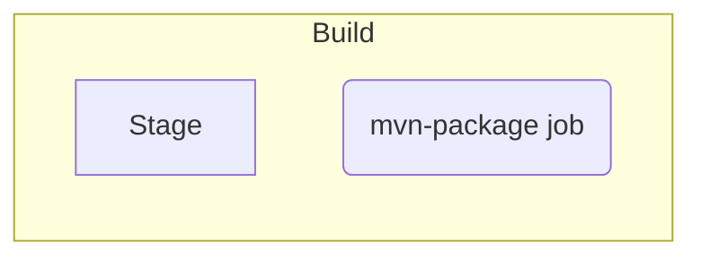
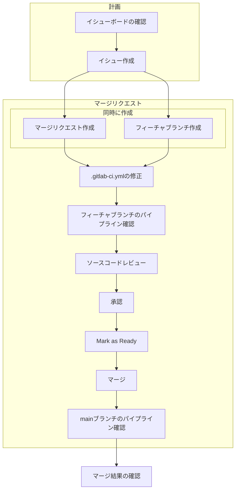

# Lab1 - .gitlab-ci.yml とビルドジョブの追加
## 目次
[[_TOC_]]

## 目的
* GitLab CI/CD パイプラインが定義されていないプロジェクトへパイプラインを新規に導入することで、ジョブとパイプライン実行開始のやり方を理解します。
    * この Lab を完了すると、フィーチャーブランチ、main ブランチにソースコードの変更が入るたびに、ビルドジョブがすぐに実行されるため、早期のビルド可否の検証を実現できます。

* `.gitlab-ci.yml` もアプリケーションやインフラのソースコードと同様に重要なプロジェクトのコードです。CI/CD パイプラインに対する変更について、イシュー、マージリクエストを経由し、各ブランチで動作を検証したあとに、main ブランチへマージするフローと操作方法を学習します。
    * [Pipeline as code](https://about.gitlab.com/topics/ci-cd/pipeline-as-code/) への理解を深めます。GitLab では必然的に Pipeline as code の方式でパイプラインを構成し、パイプラインに関するバージョン管理、監査証跡、コラボレーションの容易さ、知識共有の利点を享受できます。

## ハンズオンの課題
### 完成予定のパイプライン


### 操作の流れ

### イシューとマージリクエストの作成
ソースコード修正の背景の明確化、要件の整理、タスクの割り振り、トレーサビリティの確保など目的とし、イシューというオブジェクトを作成します。
ここでは日々のタスクの確認、割り振りが容易なイシューボードを使ってイシューを作成します。さらに、そのイシューに関連するマージリクエストを作成していきます。
1. プロジェクト [Basic CICD Workshop] の左サイドバーより [Issue] > [Boards] をクリックします。
1. [Open] のレーンにある、 [︙] > [Create new issue] をクリックし、タイトルに "Add build job" と入力し、[Create issue] をクリックします。
1. 作成したイシューのタイトル部分のリンクをクリックし、イシューの内容を開きます。
1. [Create merge request] のボタンをクリックし、このイシューに関連するマージリクエストを作成します。
    * 実際のプロジェクトでは、マージリクエストの作成をする前に、イシューに対して以下のような活動が行われますが、ここでは省略します。
        * イシューの説明の記載
        * イシューに対するコメントや議論
        * 担当者の割り振り
        * エピックやマイルストーンの設定
        * 期限の設定
        * ウェイト(ストーリーポイント)の設定
1. [New merge request] のページで、中央付近の [Assign to me] のリンクをクリックし、マージリクエストを自分にアサインします。
1. [New merge request] のページで、ページ下方の [Create merge request] のボタンをクリックします。
1. [Draft: Resolve "Add build job"] というタイトルのマージリクエストが作成されます。

### 作成したマージリクエストの確認
イシュー、マージリクエスト、ブランチが GitLab の UI でどのように関連しているか理解をします。
1. 作成されたマージリクエストについて、確認します。
    1. [Closes #1] のようにイシューの番号が説明欄に自動的に追記され、このマージリクエストがマージされると、イシューが連動してクローズされます。
    1. [1-add-build-job] というブランチがマージリクエストとともに自動的に作成され、ターゲットブランチ（マージ先）は [main] ブランチであることが分かります。（ブランチ名はマージリクエストのタイトルとIDにより異なる可能性があります。）

### .gitlab-ci.yml の追加
GitLab CI/CD パイプラインの定義ファイルである `.gitlab-ci.yml` をプロジェクトに追加し、パイプラインを開始します。
本ワークショップでは Web IDE を利用してソースコードを修正するため、ローカルのPCで `git clone` する必要はありません。

1. マージリクエストのページで `.gitlab-ci.yml`をプロジェクトのソースコードに追加するために、上方の [Code] > [Open in Web IDE] をクリックし、Web IDE のページを開きます。
1. 左側のソースコードのツリーの上部の [New File...] のアイコン :bookmark_tabs: をクリックします。
1. ファイル名を入力するフィールドが表示されるため、".gitlab-ci.yml" と入力し、Enter を押します。

### ビルドジョブの追加
1. 定義内容とテンプレートを参考にし、`.gitlab-ci.yml` に１つ目のジョブを定義します。テンプレート内の`<Code here>` の部分を正しい文字列に置き換えて、`.gitlab-ci.yml`に追記します。
    * 定義内容
        |対象|値|解説|
        | :--- | :--- | :--- |
        |ジョブ名|`mvn-package`||
        |ステージ名|`build`||
        |ジョブ実行環境のDockerイメージ名|`maven:3.8.6-openjdk-8-slim`|（読み飛ばし可）Spring PetClinic はパッケージマネージャ Maven によってビルドされる Java プロジェクトであるため、それに必要なコマンドを導入してある `maven:3.8.6-openjdk-8-slim` をジョブ実行環境として利用します。|
        |実行スクリプト|`./mvnw package -Dmaven.test.skip=true`| （読み飛ばし可） `mvn` コマンドを直接実行する代わりに プロジェクト で指定している `mvn` ラッパーコマンド `mvnw` を利用します。`./mvnw package` で一気にテストの実行まで可能ですが、今回はビルドとテストに関連するジョブとステージを分けたいため、`-Dmaven.test.skip=true` でテスト実行をスキップします。|
    * テンプレート
        ```yaml
        mvn-package:
          stage: <Code here>
          image: <Code here>
          script:
            - <Code here>
        ```
関連 GitLab Docs のページ
* https://docs.gitlab.com/ee/ci/pipelines/pipeline_architectures.html#basic-pipelines
* https://docs.gitlab.com/ee/ci/yaml/#script
* https://docs.gitlab.com/ee/ci/docker/using_docker_images.html#define-image-in-the-gitlab-ciyml-file

### ステージの追加
ジョブの追加のともない、対応するステージも定義します。 
1. `build` というステージ名を `stages` の配列として `.gitlab-ci.yml` に追加します。
    ```yaml
    stages: #Add this line
        - <Code here> #Add this line

    mvn-package:
    ...
    ```
関連 GitLab Docs のページ
* https://docs.gitlab.com/ee/ci/pipelines/pipeline_architectures.html#basic-pipelines

### 環境変数の追加
以上で、最小限のステージ、ジョブの追加は完了します。
1. 以降のハンズオンをスムーズに実施するために、以下の2行のグローバルな環境変数の定義を `.gitlab-ci.yml` のトップレベルに追記します。

    ```yaml
    variables: #Add this line
      MAVEN_OPTS: "-Dmaven.repo.local=$CI_PROJECT_DIR/.m2/repository" #Add this line

    stages:
    ...

    mvn-package:
    ...
    ```

    * 周辺の解説（スキップ可）
        * `MAVEN_OPTS`：Maven に渡したいオプションを指定するための環境変数。ここではグローバルに定義しています。
        * Maven で使用する各種依存ライブラリの保存先（Maven のローカルリポジトリ）を `$CI_PROJECT_DIR/.m2/repository` として指定することで、CIで扱いやすくします。
            * [`$CI_PROJECT_DIR`](https://docs.gitlab.com/ee/ci/variables/predefined_variables.html) はジョブ内での Git リポジトリをクローンした先のディレクトリです。


関連 GitLab Docs のページ
* https://docs.gitlab.com/ee/ci/yaml/#variables

### ソースコードのコミット
`.gitlab-ci.yml` の内容をブランチへ反映します。
1. Web IDEの左のバーの [Source Control] のボタンをクリックします。
1. [Commit & Push] ボタンをクリックします。（ここでは [Commit message] への入力は任意とします。）
1. Web IDEの上部中央に [Commit to a new branch?] が表示されるため、[No Use the current branch “1-add-build-job”] をクリックし、先ほどマージリクエストによって作成されたブランチにコミットをします。
1. Web IDEから元のマージリクエストのページに戻るために、 Web IDEの右下の [Go to MR] のボタンをクリックします。（[Go to MR] のボタンが消えた場合は、右下のベルのアイコンをクリックして、再表示させます。）

### マージリクエストのレビュー、マージ
マージリクエストのレビュアー、承認者の視点でマージリクエストのレビューをし、マージを実施します。ただし、本セクションでは、ソースコードの修正ユーザと同じユーザアカウントを使用します。

GitLab Free 版を利用の場合、マージリクエストの承認をする [Approve] ボタンは任意のボタンです。しかし、実際のプロジェクトでは、プロジェクトで設定した適切な承認者による承認がなければターゲットブランチにマージできないようにし、masterやmainブランチへの未検証のコードの混入を保護します。

1. マージリクエストのページで、[#] から始まるパイプラインのIDをクリックし、パイプラインの詳細を確認します。（コミットしてからパイプラインの実行完了まで5から10分かかります。）
1. ジョブ `mvn-package` のアイコンをクリックし、ジョブ実行中のログを確認します。
1. マージリクエストのページへ戻ります。
1. [Changes] のタブをクリックし、ソースコードの差分を確認します。
1. ソースコードの差分が正しいことを確認します。必要があればコメント（コードレビュー指摘）を行単位で入れることが可能です。[Overview] のタブをクリックして戻ります。
1. マージリクエストのタイトルの右側の [︙] > [Mark as ready] をクリックし、マージ可能な状態にします。マージリクエストのタイトルの先頭から [Draft:] が削除されたことを確認します。（通常は承認者ではなく、開発担当者としてマージをして良い判断した際にクリックします。）
1. [Approve] ボタンをクリックし、マージリクエストのマージを承認します。
1. [Merge when pipeline succeeds] の右の矢印 :arrow_down_small: から [Merge immediately] ボタンを選択し、クリックします。
    * Maven による各種依存ライブラリのダウンロードに時間がかかるため、パイプラインは通常5分から10分かかります。本 Lab では一旦「今すぐマージ」を行い、次に進みます。（パイプラインの実行を最後まで待った場合は、[Merge] ボタンが出現します。）
1. [Merged by USERNAME] の表示を確認し、マージリクエストがマージ済みであることを確認します。
1. マージリクエストがマージされたため、今度は [main] ブランチ側でパイプラインが開始されます。

### マージ後の確認
マージリクエストのマージが成功した状態で、コミットグラフの状況、[main] ブランチへの反映、イシューの状態を確認します。

1. 左側メニューの [Repository] > [Graph] より以下を確認します。
    * main ブランチより分岐し、分岐したブランチでのコミットを経て、main ブランチへ合流していること。
    * main ブランチへ合流はマージコミットにより、マージされたこと。

1. 左側メニューの [Repository] > [Files] より [main] ブランチに `.gitlab-ci.yml` が追加されていることを確認します。

1. 左側メニューの [Issue] > [Boards] よりマージ済みのマージリクエストに関連したイシューが自動的にクローズされたことを確認します。

## ハンズオン課題の解答
* [Lab1 解答](../lab1/SOLUTION.md)
