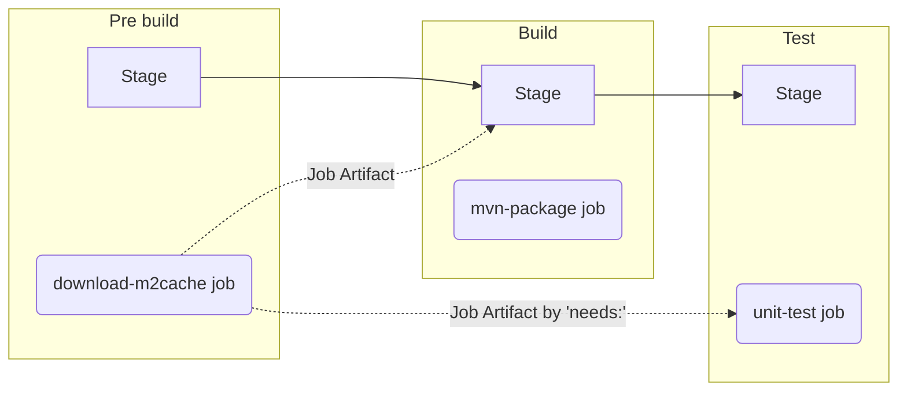
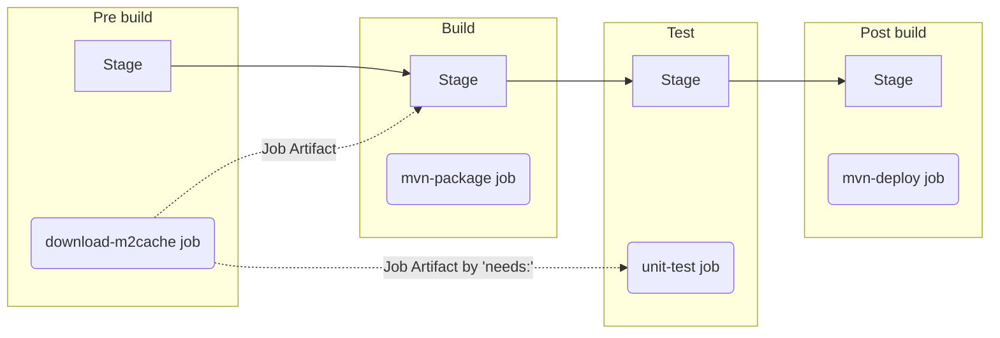

# Lab4 - ジョブの条件設定

## 目次
[[_TOC_]]

## 目的
* キーワード `rules` を活用し、main ブランチなどのデフォルトブランチのみでジョブが実行する方法を学習します。
* GitLab の CI ジョブからパッケージレジストリへ登録するための一例を体験します。
    * CI ジョブの中で GitLab API を利用して GitLab パッケージレジストリへアクセスする際に、CI ジョブ実行中のみで有効な [GitLab CI/CD job token](https://docs.gitlab.com/ee/api/index.html#gitlab-cicd-job-token) を利用して認証できることを理解します。


## ハンズオンの課題
### 完成予定のパイプライン
* Pipeline in feature branches (Merge Requests)


* Pipeline in the default branch

### イシューとマージリクエストの作成
イシューのタイトルを “Deploy jar only in main branch” とし、
[Lab1 のイシューとマージリクエストの作成](../lab1/README.md#イシューとマージリクエストの作成) を参照して同様に操作します。

### mvn-deployのジョブの条件追加
デフォルトブランチであるmainブランチの場合のみ、ジョブ `mvn-deploy` を実行するように条件を追加します。
1. マージリクエストのページで、 [Code] > [Open in Web IDE] をクリックし、Web IDE のページを開きます。
1. Web IDE の左側のソースコードのツリーから [.gitlab-ci.yml] をクリックし、以下の定義対象の内容とテンプレートにしたがってのジョブ定義を追加します。
    * 定義対象
      |対象|値|解説|
      | :--- | :--- | :--- |
      |条件|`'$CI_COMMIT_BRANCH == $CI_DEFAULT_BRANCH'`|ジョブの実行ブランチがデフォルトブランチ（通常は main）であれば `true` になる条件です。|
    * テンプレート
      ```yaml
      mvn-deploy:
        stage: post build
        image: maven:3.8.6-openjdk-8-slim
        script:
          - ./mvnw deploy -s ci_settings.xml -Dmaven.test.skip=true
        <Code here>:
          - <Code here>: <Code here>
      ```
    * 周辺の解説（スキップ可）
      * `./mvnw deploy` は Maven でビルドした jar ファイル等を Maven のリモートリポジトリへ登録するためのコマンドです。「デプロイ」よりも「デリバリー」や「リリース」の方が感覚的に近いかもしれません。
      * GitLab の Maven 用のパッケージレジストリ（Maven リポジトリ）へアクセスするために、GitLab CI/CD パイプラインのジョブで一時的に発行される [GitLab CI/CD job token](https://docs.gitlab.com/ee/ci/jobs/ci_job_token.html) で認証します。
        * `ci_settings.xml` に `${env.CI_JOB_TOKEN}` を記載することで、環境変数 `$CI_JOB_TOKEN` を Maven の設定ファイルに渡しています。（[Create Maven packages with GitLab CI/CD using Maven](https://docs.gitlab.com/ee/user/packages/maven_repository/#create-maven-packages-with-gitlab-cicd-using-maven)）
      * GitLab パッケージレジストリを Maven のリモートリポジトリとして登録するために、Maven リポジトリの設定について、以下のように設定を追記します。298、305行目に、`<repository>` と  `<distributionManagement>` の設定を追加しています。（[Create Maven packages with GitLab CI/CD using Maven](https://docs.gitlab.com/ee/user/packages/maven_repository/#create-maven-packages-with-gitlab-cicd-using-maven)）

関連 GitLab Docs のページ
* https://docs.gitlab.com/ee/ci/jobs/job_control.html#rules-examples

### ステージの追加
テスト済みのソースコードのみをリモートリポジトリへ登録するようにするため、ステージ `test` の後にジョブ `mvn-deploy` が実行されるようにします。
1. `stages` の定義が以下になるように、`post build` というステージを `test` の後に追加します。
    ```yaml
    stages:
      - pre build
      - build
      - test
      - post build #Add this line
    ```

### ソースコードのコミット
[Lab1 の .gitlab-ci.yml のコミット](../lab1/README.md#ソースコードのコミット) を参照して同様に操作します。

### パイプライン実行結果の確認
変更内容の特性上、フィーチャーブランチ（マージリクエスト）でのパイプラインでは条件の正しさが完全に検証できないため、`mvn-deploy` のジョブが存在しないことを確認したらマージリクエストをマージします。
1. マージリクエストのパイプラインに `mvn-deploy` のジョブが存在しないことを確認します。
1. [Mark as ready] のボタンをクリックします。
1. [Merge when pipeline succeeds] の右の矢印 :arrow_down_small: から [Merge immediately] のボタンを選択し、クリックします。
1. main ブランチ側のパイプラインには `mvn-deploy` のジョブが存在することを確認できたら、正しく定義できています。
1. main ブランチ側のパイプラインが完了したら、左側メニューの [Packages and registries] > [Package Registry] をクリックします。
1. パッケージレジストリのページで、[org/springframework/samples/spring-petclinic] (2.4.5) が Maven リポジトリのビルドパッケージとして登録されていることを確認し、タイトルをクリックします。 
1. [org/springframework/samples/spring-petclinic] のページの下方より、`spring-petclinic-2.4.5.jar` がダウンロードできることを確認します。


# ハンズオンの解答
* [Lab4 解答](../lab4/SOLUTION.md)