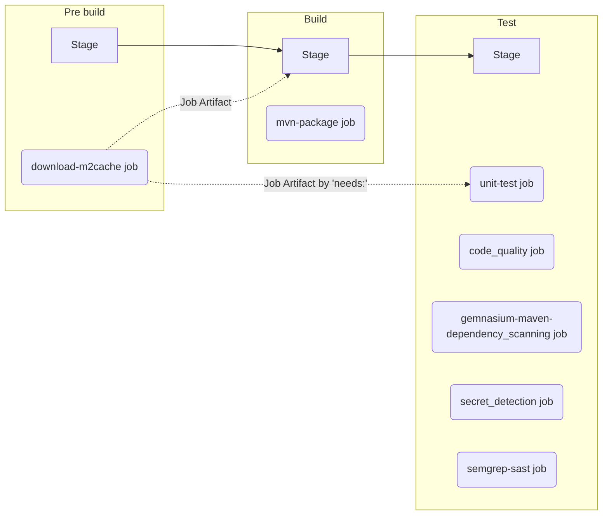

# Lab6 - 品質とセキュリティスキャン

## 目次
[[_TOC_]]

## 目的
* 外部の `.gitlab-ci.yml` を自プロジェクトのパイプラインに取り組むためのキーワード `include` の使い方を学習します。
* GitLab が提供する `.gitlab-ci.yml` テンプレートを利用することで、[Code Quality](https://docs.gitlab.com/ee/user/project/merge_requests/code_quality.html) や [各種セキュリティスキャン](https://docs.gitlab.com/ee/user/application_security/)、[コンプライアンススキャン](https://docs.gitlab.com/ee/user/compliance/license_scanning_of_cyclonedx_files/index.html)が手軽に開始できることを理解します。
* 脆弱性レポートから脆弱性の状態の管理、脆弱性からのイシュー作成が実施でき、DevSecOpsを実現するためのスムーズなワークフローをGitLabがサポートしていることを確認します。


## ハンズオンの課題
### 完成予定のパイプライン
* Pipeline in feature branches (Merge Requests)


### イシューとマージリクエストの作成
イシューのタイトルを “Add quality and security test"” とし、
[Lab1 のイシューとマージリクエストの作成](../lab1/README.md#イシューとマージリクエストの作成) を参照して同様に操作します。

### テンプレートの include
Code Quality、依存関係スキャン、ライセンススキャン（依存関係スキャン内で実施）、SAST、Secret Detectionを既存のパイプラインに追加します。

1. マージリクエストのページで、 [Code] > [Open in Web IDE] をクリックし、Web IDE のページを開きます。
1. Web IDE の左側のソースコードのツリーから [.gitlab-ci.yml] をクリックし、以下のテンプレートを追記します。
    * テンプレート
        ```yaml
        include:
        - template: Jobs/Code-Quality.gitlab-ci.yml  # https://gitlab.com/gitlab-org/gitlab/blob/master/lib/gitlab/ci/templates/Jobs/Code-Quality.gitlab-ci.yml
        - template: Security/Dependency-Scanning.gitlab-ci.yml  # https://gitlab.com/gitlab-org/gitlab/blob/master/lib/gitlab/ci/templates/Security/Dependency-Scanning.gitlab-ci.yml
        - template: Security/SAST.gitlab-ci.yml  # https://gitlab.com/gitlab-org/gitlab/blob/master/lib/gitlab/ci/templates/Security/SAST.gitlab-ci.yml
        - template: Security/Secret-Detection.gitlab-ci.yml  # https://gitlab.com/gitlab-org/gitlab/blob/master/lib/gitlab/ci/templates/Security/Secret-Detection.gitlab-ci.yml
        ```

関連 GitLab Docs のページ
* https://docs.gitlab.com/ee/user/project/merge_requests/code_quality.html
* https://docs.gitlab.com/ee/user/application_security/sast/index.html
* https://docs.gitlab.com/ee/user/application_security/dependency_scanning/
* https://docs.gitlab.com/ee/user/application_security/secret_detection/
* https://docs.gitlab.com/ee/user/compliance/license_scanning_of_cyclonedx_files/index.html

### ソースコードのコミット
[Lab1 の .gitlab-ci.yml のコミット](../lab1/README.md#ソースコードのコミット) を参照して同様に操作します。

### パイプライン実行結果の確認
1. マージリクエストのページで、[#] から始まるパイプラインのIDをクリックすると、パイプラインの詳細が確認できます。
1. マージリクエストのパイプラインの `test` ステージに各種スキャンジョブが追加されていることを確認します。
    * 言語やパッケージマネージャが自動判別されて、必要なスキャンジョブが追加されています。
1. （各種ジョブの実行に時間がかかるため、5分から10分後に再度確認します。）パイプラインページの [Security] のタブから検出された脆弱性の一覧を確認します。
1. （各種ジョブの実行に時間がかかるため、5分から10分後に再度確認します。）パイプラインページの [Licenses] のタブから検出されたライセンスの一覧を確認します。
1. （各種ジョブの実行に時間がかかるため、5分から10分後に再度確認します。）パイプラインページの [Code Quality] のタブから検出された品質の問題の一覧を確認します。
1. （各種ジョブの実行に時間がかかるため、5分から10分後に再度確認します。）[!] から開始するマージリクエストのリンクより、マージリクエストのページに戻り、 [Approve] のボタンの下方あたりに、以下の検出結果の概要が出力されていることを確認します。
  1. Code Quality
  1. License Compliance
  1. Security scanning
1. [Mark as ready] ボタンをクリックします。
1. [Merge when pipeline succeeds] の右の矢印 :arrow_down_small: から [Merge immediately] のボタンを選択し、クリックします。（本来は、各種脆弱性、品質、ライセンスの問題を解消してからマージリクエストをマージするべきです。）

### マージ後のパイプライン実行後の確認
1. main ブランチでのパイプラインの実行完了を待ちます。
1. 左側メニューの [Security and Compliance] > [Vulnerability report] から main ブランチで検出された脆弱性一覧を確認します。
   1. [Description] の列にある任意の脆弱性のリンクをクリックし、脆弱性の詳細を確認します。
   1. [Create issue] のボタンをクリックすると脆弱性からイシューを関連付けて、イシューの作成ができることを確認します。
1. 左側メニューの [Security and Compliance] > [Dependency list] から main ブランチで検出された依存リスト（SBOM）の一覧を確認します。

# ハンズオンの解答
* [Lab6 解答](../lab6/SOLUTION.md)


